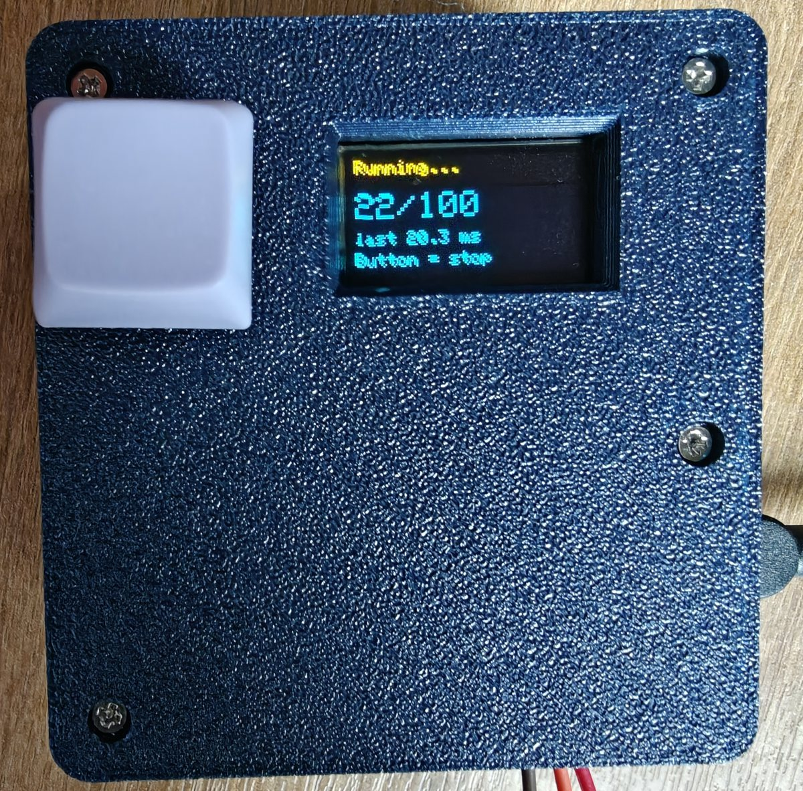
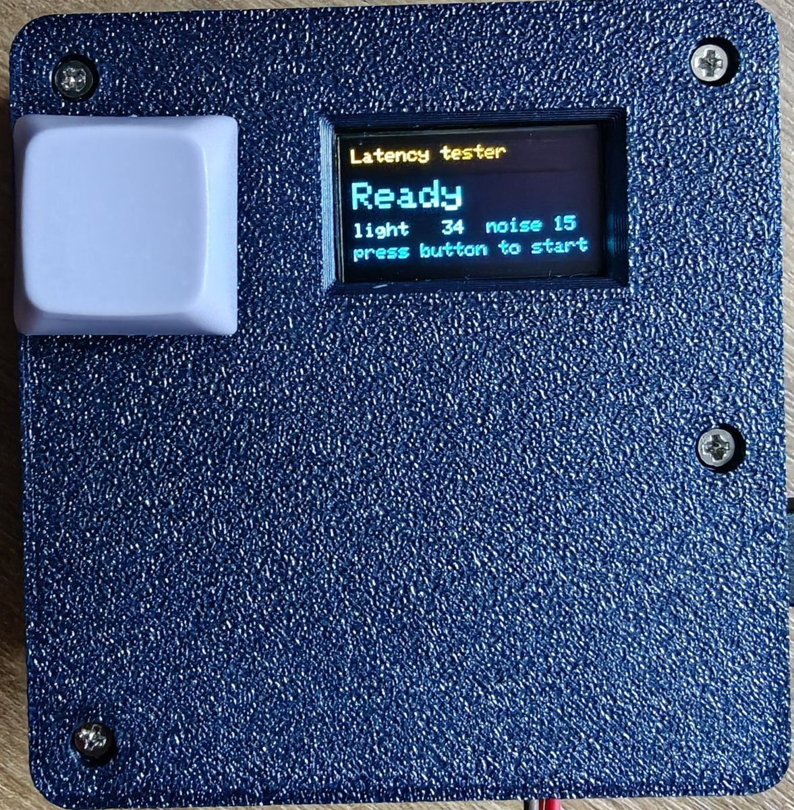
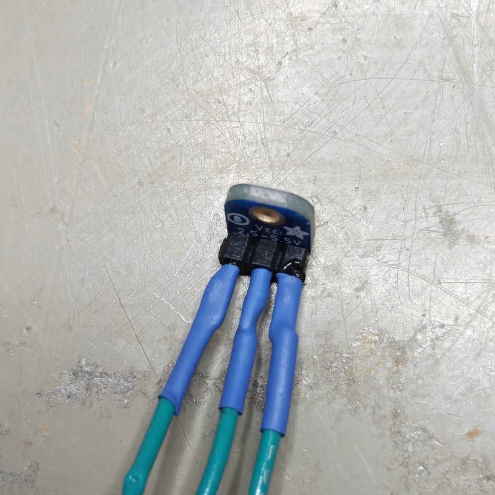
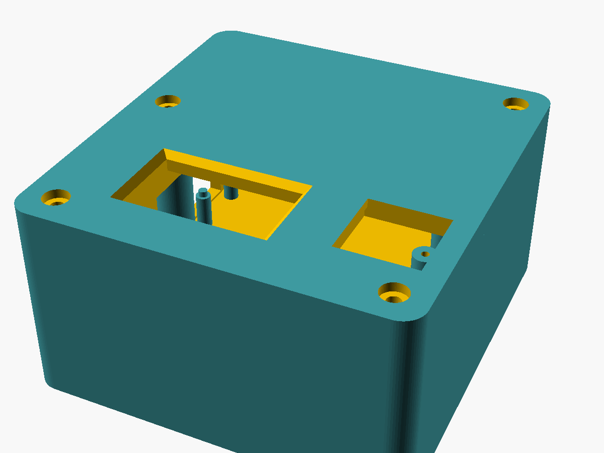
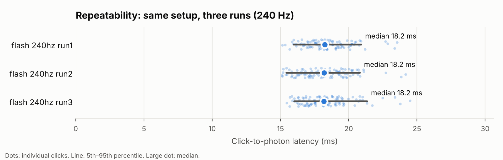
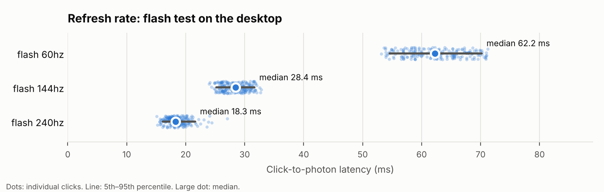

# Pico Latency Tester

[](https://github.com/JackVermaak/pico-latency-tester/actions/workflows/build.yml)
[](https://github.com/JackVermaak/pico-latency-tester/releases/latest)
[](LICENSE)

Measures **click-to-photon latency**: the time from a mouse click to the moment the screen changes. That covers USB, Windows, the game or app, the GPU and the monitor.

The Pico acts as a 1000 Hz USB mouse. For each sample it reads the screen brightness, sends a left click, starts a microsecond timer and watches a light sensor stuck to the monitor until the brightness changes. A run is 100 samples, with random gaps so the clicks don't line up with the refresh rate. The OLED shows the live result. Every sample also goes over USB serial, so `pc/latency_log.py` can save it to CSV.

<p align="center">
  
  
  
</p>

**Result:** on a 240 Hz monitor the Windows desktop path measures **18 ms** median click-to-photon, against **62 ms** at 60 Hz. [Full results ↓](#results)

**Status:** built and working.

## Repository layout

| Path | Contents |
| --- | --- |
| `firmware/latency_tester_pico2w.uf2` | Ready-to-flash firmware for the Pico 2 W / 2 WH |
| `firmware/latency_tester/` | Arduino source (`latency_tester.ino` + `tester.cpp`) |
| `pc/latency_log.py` | Logs runs to CSV and prints mean / median / percentiles |
| `pc/flash_test.html` | Black page that turns white while the mouse button is held, for testing without a game |
| `pc/auto_flash.py` | Windows: runs flash tests unattended (own full-screen window, can switch refresh rate) |
| `pc/analyze.py` | Turns `results.csv` into a Markdown table and a chart |
| `docs/TESTING.md` | Test protocol behind the published results |
| `docs/results/` | Raw samples (`raw.csv`) and the charts in the Results section |
| `case/latency_tester.scad` | Parametric OpenSCAD source |
| `case/stl/` | `box.stl`, `lid.stl`, `oled_clamp.stl`, `sensor_cup.stl` |

## Parts

| Qty | Part | Notes |
| --- | --- | --- |
| 1 | Raspberry Pi Pico 2 WH (Pico 2 W with headers) | Pico / Pico W / Pico 2 also work if you build from source |
| 1 | Adafruit ALS-PT19 analog light sensor breakout (product 2748) | |
| 1 | 0.96″ SSD1306 OLED, I²C, 4-pin | |
| 1 | Cherry MX (or compatible) switch + keycap | Start button |
| 1 | Micro-USB **data** cable | |
| ~13 | Female–female Dupont jumpers, 20 cm | |
| 8 | M2 self-tapping screws: 4× M2×10 (lid), 4× M2×6 (Pico, OLED clamp) | |
| 4 | Self-adhesive rubber feet, up to 12.5 mm across | |
| — | Solder, heat-shrink tubing, ~60 g PLA (sensor cup in **black**), elastic band or tape | |

**No MX switch?** Any momentary pushbutton between GP15 and GND works. Glue it under the MX hole, or leave the button out and start runs with the serial `s` command.

## Wiring

The Pico sits **upside down** in the box (header pins pointing up), so the pin labels printed on its underside face you. Plug everything into the header with jumpers; nothing is soldered to the Pico.

| From | To Pico pin | Physical pin |
| --- | --- | --- |
| Sensor **+** (VIN) | GP27 | 32 |
| Sensor **−** (GND) | AGND | 33 |
| Sensor **OUT** | GP26 / ADC0 | 31 |
| Button leg 1 | GP15 | 20 |
| Button leg 2 | GND | 18 |
| OLED **VCC** | 3V3(OUT) | 36 |
| OLED **GND** | GND | 38 |
| OLED **SDA** | GP4 | 6 |
| OLED **SCL** | GP5 | 7 |

```
 Pico 2 WH: pins 1-20 run down one side from the USB end, 21-40 back up the other
   GP4  pin 6  ── OLED SDA            pin 36 3V3(OUT) ── OLED VCC
   GP5  pin 7  ── OLED SCL            pin 38 GND      ── OLED GND
   GND  pin 18 ── switch              pin 33 AGND     ── sensor −
   GP15 pin 20 ── switch              pin 32 GP27     ── sensor +
                                      pin 31 GP26     ── sensor OUT
```

Notes:
- **The sensor runs from GP27**, which the firmware drives high. It draws well under 1 mA, so it's fine, and its three wires land on three neighbouring pins (31–33). AGND is the quiet analog ground, which gives cleaner readings.
- **Wire the OLED by the labels printed on the module.** VCC and GND swap places between batches.
- **Sensor lead (about 35 cm):** for each of the three lines, join two jumpers end to end (one with a plug left on, one with both plugs cut off), soldered under heat shrink. Push the bare ends through the sensor pads from the back of the board, solder on the front and trim flush so the board sits flat in the cup. Twist the three wires loosely together. Before gluing anything, plug the lead in and check that covering the sensor makes the light level on the OLED drop.
- **Switch:** cut two jumpers about 3 cm from one end and solder those ends to the switch legs.

## Printing



PLA (or PETG), 0.2 mm layers, 3 walls, 15–20 % infill, no supports. About 60 g in total; the box takes about 1 h 45 min on a Bambu Lab printer.

| Part | Orientation | Notes |
| --- | --- | --- |
| `box.stl` | open side up | 1.5–4 h depending on printer and profile; the USB hole in the left wall bridges cleanly |
| `lid.stl` | already flipped, top face on the bed | 35 min–1.5 h; the MX hole has a 1.5 mm skin for the switch clips |
| `oled_clamp.stl` | flat | 5 min |
| `sensor_cup.stl` | flat, as exported | **print in black (or another dark, opaque filament)**; a light colour lets room light reach the sensor. The slotted side tabs are strap loops for an elastic band or tape. |

The box is 68 × 71 × 36 mm assembled. If holes come out too tight or loose on your printer, adjust `switch_cutout`, `pilot_hole` or `clearance_hole` at the top of `latency_tester.scad` and re-export:

```
openscad -D 'part="box"' -o stl/box.stl latency_tester.scad
```

## Assembly

1. **Flash the Pico first** (next section), so you know the board works before it goes in the box.
2. **Pico:** set it upside down on the four posts, USB socket toward the hole in the left wall. The two thin pegs at the USB end locate it. Screw the far end down with 2× M2×6.
3. **Switch:** snap the MX switch into the lid from the top and fit the keycap.
4. **OLED:** turn the lid over and lay the module in its pocket, glass toward the window and pins toward the back. Hold it with the clamp and 2× M2×6, snug but not tight: the glass cracks easily.
5. **Sensor:** push the breakout into the sensor cup, sensor side toward the slot window. Glue it if it's loose. Feed the lead in through the notch at the top of the back wall.
6. **Plug in** all jumpers as in the wiring table. Tuck the wires to the sides so they don't press on the OLED.
7. **Close** the lid with 4× M2×10 and stick the four feet into the recesses underneath.

## Flashing the firmware

**Easy way:** download the `.uf2` from the [latest release](https://github.com/JackVermaak/pico-latency-tester/releases/latest) (or use `firmware/latency_tester_pico2w.uf2`). Hold BOOTSEL and plug the Pico into the PC, then drag the file onto the `RP2350` drive that appears. It reboots into the tester.

Every push is compiled with arduino-cli by GitHub Actions, and the release `.uf2` is built by CI from the tagged source.

**Arduino IDE (to change settings):**
1. Boards Manager URL: `https://github.com/earlephilhower/arduino-pico/releases/download/global/package_rp2040_index.json`, then install **Raspberry Pi Pico/RP2040/RP2350** (built and tested with 6.3.1).
2. Library Manager: **Adafruit SSD1306** (installs Adafruit GFX too).
3. Board: **Raspberry Pi Pico 2W**. Tools → USB Stack: **Adafruit TinyUSB** (required; it's what gives the 1 ms polling).
4. Open `firmware/latency_tester/latency_tester.ino`; the code itself is in the `tester.cpp` tab. Settings are at the top.

The tester is Arduino rather than CircuitPython on purpose: CircuitPython's USB HID polls every 8 ms, which would add up to 8 ms of jitter to every sample. With TinyUSB at 1 ms, the tester adds less than 1 ms.

## Using it

**The tester clicks wherever the mouse cursor is**, in whatever window has focus. Get the target window ready before you start a run.

### Quick test: browser
1. Open `pc/flash_test.html` and press **F** for fullscreen.
2. Put the sensor cup against the screen and hold it with an elastic band around the monitor, or tape.
3. Press the tester's button. The OLED counts up the samples, then shows the mean, median, min and max. Press the button again to stop early.

### In a game (e.g. CS2)
- Find something that changes brightness the instant you click: the muzzle flash, or a dark wall that lights up when you fire. Put the sensor there. Bigger brightness changes give cleaner triggers.
- Use an offline map with infinite ammo (`sv_cheats 1; sv_infinite_ammo 1`) so a run of 100 shots doesn't need reloads.
- Change **one** thing per run (Reflex on/off, fullscreen vs windowed, frame cap, refresh rate) and label each run.

### Logging on the PC
```
pip install pyserial
python pc/latency_log.py COM9 --label "cs2 reflex on"
```
The port is the "USB Serial Device" in Device Manager → Ports. The script starts a run, appends every sample to `results.csv` and prints mean / median / stdev / 5th–95th percentile.

To summarise several runs into a table and chart for sharing:
```
pip install matplotlib
python pc/analyze.py --only "cs2 vsync off" "cs2 vsync on" --title "CS2: V-Sync" --out vsync
```
The test protocol is in [docs/TESTING.md](docs/TESTING.md).

Serial commands (any terminal, 115200 baud): `s` start, `x` stop, `l` print the current light level and noise.

### Reading the numbers
- Use the **median** to compare setups, since the mean is pulled up by outliers.
- A 144 Hz monitor alone adds 0–7 ms depending on where in the refresh the click lands, so expect a spread.
- The result includes the monitor's own pixel response, which is the true end-to-end figure. It's what you see, so it's what matters.

## Results

Measured on 19 November 2026 on a Windows PC with an NVIDIA RTX 5070 Ti and a 1080p 240 Hz monitor.
The flash tests use `pc/auto_flash.py`, a plain full-screen window that turns white on each click, so
they measure the Windows desktop path: USB, Windows, the window redrawing, the desktop compositor and
the monitor. 100 clicks per run. Raw data: [`docs/results/raw.csv`](docs/results/raw.csv); method:
[`docs/TESTING.md`](docs/TESTING.md).

### Repeatability



| Setup | Median | Mean | 5th–95th pct | Std dev | n |
| --- | ---: | ---: | ---: | ---: | ---: |
| 240 Hz, run 1 | **18.2 ms** | 18.4 ms | 16.0–20.9 ms | 1.7 ms | 100 |
| 240 Hz, run 2 | **18.2 ms** | 18.2 ms | 15.4–20.8 ms | 1.9 ms | 100 |
| 240 Hz, run 3 | **18.2 ms** | 18.3 ms | 16.0–21.3 ms | 1.8 ms | 100 |

Three identical runs land within 0.1 ms of each other, so differences much larger than that between
setups are real, not noise.

### Refresh rate



| Refresh rate | Median | Mean | 5th–95th pct | Std dev | n |
| --- | ---: | ---: | ---: | ---: | ---: |
| 60 Hz | **62.2 ms** | 62.3 ms | 54.6–70.2 ms | 4.9 ms | 200 |
| 144 Hz | **28.4 ms** | 28.4 ms | 25.2–31.7 ms | 2.1 ms | 200 |
| 240 Hz | **18.3 ms** | 18.5 ms | 16.1–21.6 ms | 1.8 ms | 200 |

- **240 Hz cuts desktop latency from 62 ms to 18 ms**, 71 % less than 60 Hz; 144 Hz gets to 28 ms.
- Across the three rates, latency fits **about 3.8 ms + 3.5 refresh periods**. The desktop compositor
  works in whole frames, so the refresh rate matters far more than the raw frame time suggests.
- The 5th–95th spread is about one refresh period at each rate (15.7 ms at 60 Hz, 6.5 ms at 144 Hz,
  5.6 ms at 240 Hz): what you'd expect from clicks landing at random points in the refresh cycle,
  leaving little room for measurement noise.

## Troubleshooting

| Symptom | Fix |
| --- | --- |
| Lots of `miss` / timeouts | The brightness change is too small. Use a bigger white flash, darken the room, check the cup sits flat on the screen. Run `l` to see the level, then try lowering `MIN_DELTA` (60 by default). |
| Triggers instantly, with impossibly low values | Room light is leaking in or the screen flickers (PWM dimming). Use the black cup, set the monitor brightness to 100 %, or raise `MIN_DELTA` / `NOISE_FACTOR`. |
| OLED stays blank | Check VCC/GND against the module labels. Some modules are at address 0x3D: change `OLED_ADDRESS`. |
| No clicks happen | Check that the firmware was built with **USB Stack: Adafruit TinyUSB** (the prebuilt UF2 is). Windows should list a new HID mouse. |
| Light level never changes | Check the sensor wiring: OUT goes to GP26 (pin 31), + to GP27 (pin 32). |

## Related

Built alongside the [Pico Mixpad](https://github.com/JackVermaak/pico-mixpad), a USB audio-control macropad,
to check that the pad adds no input lag in games.

## Licence

MIT
